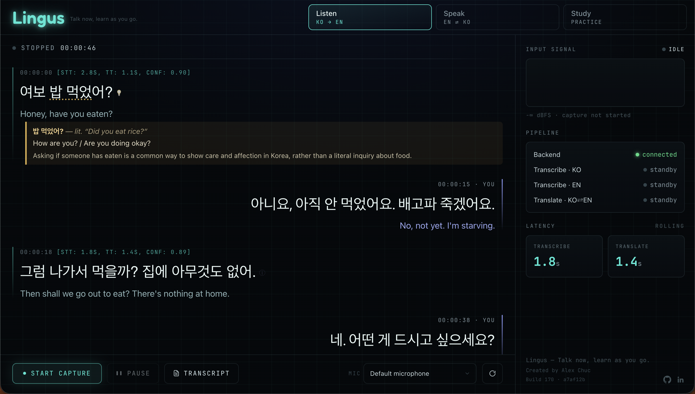
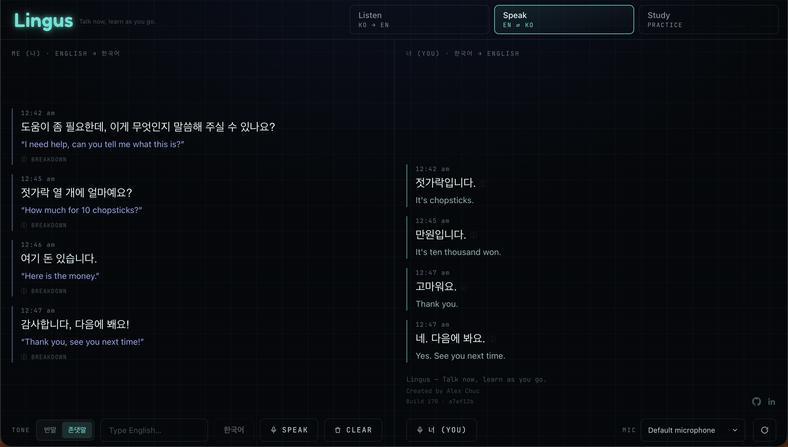
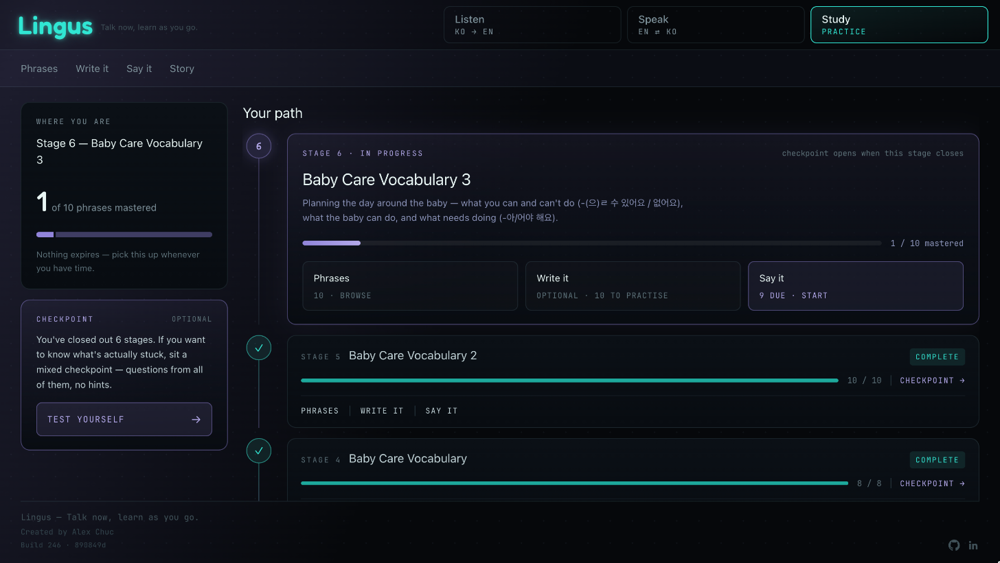
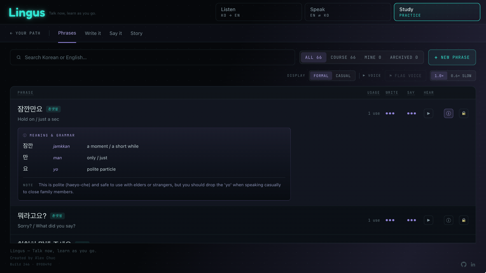
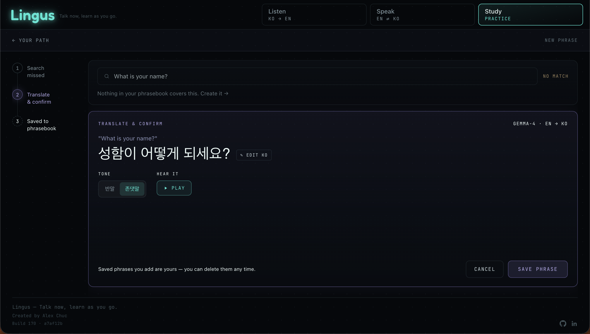
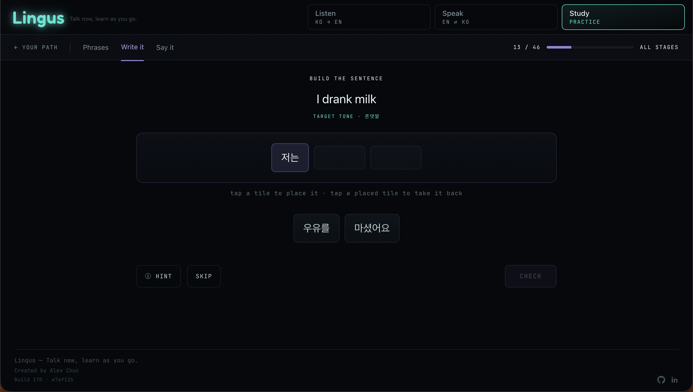
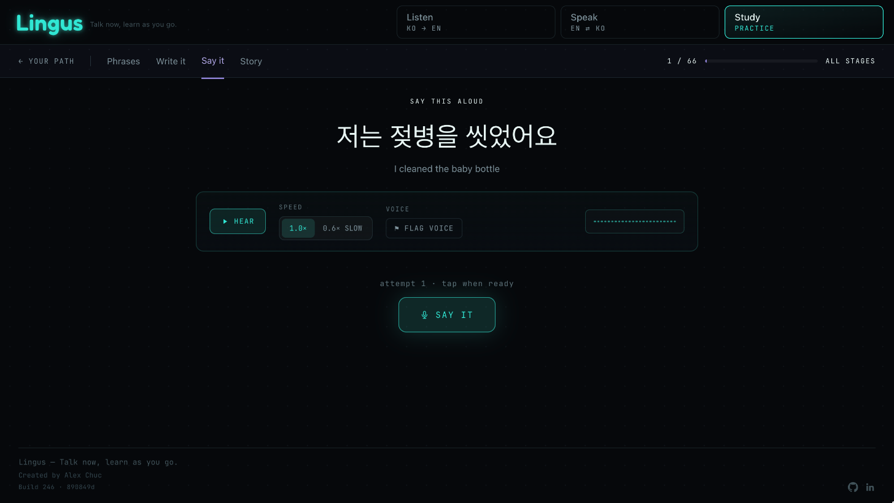
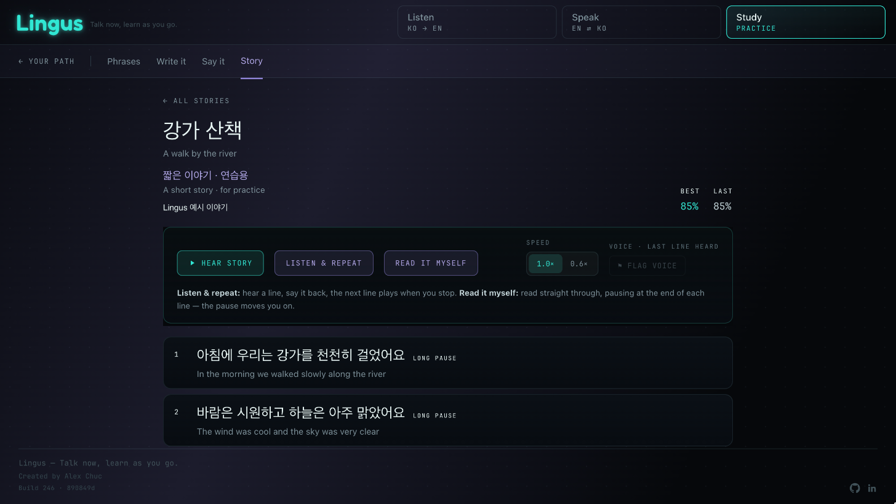
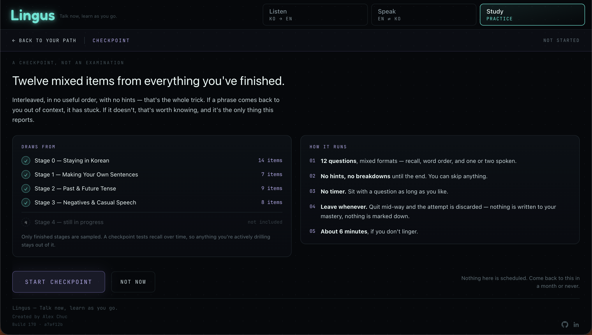

# Lingus — Talk now, learn as you go. (Public)

Self-hosted Korean ↔ English language tool built for live calls (voice/video) with Korean-speaking family and for structured study between calls. Three tabs: **Listen** (real-time KO→EN transcription), **Speak** (EN→KO composition), and **Study** (staged curriculum, read-along stories and spoken practice graded on whether you were understood).

Production deployment: `lingus.alexchuc.au`

---

## The problem

Every common translation app — Google Translate, Papago, Microsoft Translator — stops transcribing on silence. Natural conversation, especially with an elder speaker, has 3–5 second pauses between thoughts. Every pause kills the transcript and breaks the flow.

A secondary constraint shaped the entire architecture: the target phone runs GrapheneOS, which blocks Google Play Services. The browser-native Web Speech API depends on Google's speech recognition — blocked entirely. That pushed the full STT/translation/TTS stack off-device and ruled out browser-native speech recognition across the whole app.

---

## Architecture

```
┌──────────────────────────────────┐
│  Mac (BlackHole virtual audio)   │
│  captures call audio digitally   │
└────────────┬─────────────────────┘
             │ 1. clean audio, no re-recording
             ▼
┌──────────────────────────────────┐
│  Browser — React SPA             │
│  AudioWorklet · silence-boundary │
│  VAD segments per utterance      │
└────────────┬─────────────────────┘
             │ 2. WAV per utterance
             ▼
┌──────────────────────────────────┐
│  Whisper → STT                   │
│  (whisper.cpp on the Mac for     │
│  calls; Workers AI on the phone) │
│  Gemma 4 on Workers AI →         │
│  translation (both directions,   │
│  5-turn rolling context window)  │
└────────────┬─────────────────────┘
             │ 3. static build + Pi-side persistence
             ▼
┌──────────────────────────────────┐
│  Pi 4B (self-hosted)             │
│  nginx · Cloudflare Tunnel       │
│  studystore service (Python)     │
│  EchoVoice Korean audio clips    │
│  (no inbound ports required)     │
└──────────────────────────────────┘
```

**Architecture non-negotiables:** desktop browser for live calls; phone for study. Live-call speech is transcribed on the Mac by a local whisper.cpp helper, so call audio never leaves the machine. Phone study features send recordings through a Cloudflare Worker to Whisper on Workers AI. The Pi serves the static React build, the Study/Speak persistence store and the pre-generated Korean audio — it never touches live call traffic.

**No paid speech service.** Speech-to-text is Whisper (local or Workers AI), translation is Gemma 4 on Workers AI, and every Korean voice line is pre-rendered by [EchoVoice](#voices--echovoice), a local TTS engine on the Mac. The Worker holds no API keys.

---

## Listen — KO → EN

Real-time Korean speech to English transcription during a live call (voice/video). Audio is captured digitally via BlackHole (no mic re-recording) and segmented by silence boundaries via AudioWorklet VAD — utterances are not cut mid-sentence regardless of pause length. Each segment goes to a local Whisper helper on the Mac (whisper.cpp large-v3-turbo + Silero VAD), then to Gemma 4 with a 5-turn rolling context window for coherent pronoun resolution across turns.

The live pipeline health rail shows backend connectivity, transcription and translation latency, and confidence score per utterance in real time.



**Key implementation decisions:**

- **STT went Whisper → Azure → local Whisper — each move measured.** Whisper on Workers AI averaged 4.5s per utterance with spikes to 11.6s, caused by Workers AI queueing rather than cold starts, so warming could not fix it. Azure Speech (ko-KR) averaged 1.1s on the first real call and replaced it. A later benchmark — whisper.cpp large-v3-turbo on the Mac against Azure, 150 synthetic clips across 3 voices and 5 noise levels — found local Whisper matched Azure on clean to moderate noise (2.3% vs 2.7% character error) and was faster (0.58s vs 0.84s). Azure only led at ≤0 dB, ruled out of scope. Two published Korean Whisper fine-tunes scored *worse* than stock.
- **Azure removed entirely.** Three reasons: no paid cloud dependency, call audio stays on the Mac, and Azure's Korean voices sounded unnatural (see [Voices](#voices--echovoice)). No Azure fallback, by design: if the local helper isn't running, Start shows a banner and the status rail turns red.
- **One Whisper pass per line.** whisper-server crashes on a `verbose_json` request when its VAD finds no speech, so the helper first asked for plain text and only then for word detail — two passes, ~1.6–1.8s per line. Now it asks for `verbose_json` straight away and treats a crash as "no speech" (reload ~0.5s, confirm with a plain pass). On 210 benchmark clips: median 1.65s → 1.08s, max 8.4s → 2.2s, identical text on every clip. Root cause traced to a null language string in whisper.cpp's server (upstream issue #3595).
- **Silence must stay silent.** Whisper invents phrases on silence ("감사합니다", YouTube-style outros such as "see you in the next video") — Silero VAD drops all-silent clips, and known outros are stripped from noisy tails in both the local helper and the Worker.
- **AudioWorklet replaced MediaRecorder.** The original STT engine (Whisper) rejected WebM outright. Fixed-interval chunking cut Korean's SOV sentences mid-utterance — because the verb comes last, cutting at four seconds loses the entire meaning. AudioWorklet with silence-boundary VAD sends one complete utterance per request.
- **Transcript lines ordered by capture time, not STT arrival** — prevents out-of-order display when network latency varies between concurrent requests. Each segment is timestamped at speech onset and inserted by capture time, not arrival order.
- **Gemma 4 keep-warm heartbeat** runs every 45 seconds during live calls to minimise cold-start latency. Gemma cold-starts at 10–40s; warm it runs at ~0.5s.
- **Rolling context window (5 turns)** — stateless translators guess wrong on homophones and idioms without conversational context. Context lines are labelled by side (you / them), and the prompt resolves Korean's dropped subjects from the speaker's previous line. Fixes are kept general-purpose — never tuned to one speaker.
- **Gemma 4 over Llama — benchmark-driven, not assumed.** Llama introduced subject-pronoun errors on Korean under concurrent load: a sentence meaning "I feel the cold" was translated as "You feel the cold." Gemma 4 handled 8 parallel requests at 750ms with zero failures in a proper concurrent benchmark. The initial Gemma → Llama → Gemma reversion arc: Gemma queued catastrophically in July 2026 (6–78s under 8 concurrent requests) and was temporarily replaced by Llama on the live path. An August re-benchmark found the issue did not reproduce; Llama's Korean accuracy problems were the deciding factor to revert. Lesson: benchmark concurrency, not just sequential warm calls.
- **Client-side idiom dictionary** — detects known idioms and proverbs and flags their actual meaning regardless of which STT model produced the text, even when the translation is technically correct but culturally wrong. Matches on pattern, not perfect text, so it catches STT errors on known phrases.
- **Deterministic Korean numeral parser** — dates, times, and money amounts are computed by code, not the model. Gemma 4 produced consistent numeral errors (wrong month, wrong denomination) that a parser eliminates entirely. STT writes numbers as digits or words depending on context; the parser handles both. A prompt nudge to fix this was tested and failed — it is a model capability limit, not a wording problem. The rule: the LLM does language; code does the math.
- **Two "unclear" signals.** Whisper's mean word probability drives a low-confidence flag: re-tuned for Whisper at 0.80, it flagged 22 of 31 badly misheard bench clips and 8 of 89 exact ones. Separately, Gemma starts its answer with a `[?]` marker when it can't tell what was meant; the Worker strips it and Listen flags the line the same way. Flagged lines render with an amber tint and a prompt to ask for repetition.
- **Speaker diarization prototyped and removed** — complexity did not survive real-call validation. Pause/Unpause replaced it.
- **Whisper prompt biasing tested and removed** — a Korean name prompt echoed back on silence.

---

## Speak — EN ⇄ KO

Bidirectional composition panel for practising Korean in a live or in-person conversation. Left column: type English, Gemma 4 translates to Korean with formal/casual tone toggle (반말/존댓말), with per-entry sentence breakdown. Right column: the other speaker's Korean side, transcribed and translated to English in real time.

Conversation history is persisted server-side on the Pi. Browser localStorage was evicted by Brave's aggressive memory management under load — server-side persistence was the correct fix.



---

## Study — structured curriculum from real call data

A structured Korean curriculum across staged lessons, each introducing new grammar or vocabulary before gating the next. Study data is persisted server-side on the Pi via a small Python stdlib service (`studystore`) for cross-device access — a design decision forced by the same localStorage eviction issue discovered in Speak. Real conversation phrases can also be imported from KakaoTalk chat exports into the phrasebook.

### Your Path

Staged curriculum, each stage gating on completion before the next opens:

| Stage | Topic |
|---|---|
| 0 | Staying in Korean |
| 1 | Making Your Own Sentences |
| 2 | Past & Future Tense |
| 3 | Negatives & Casual Speech |
| 4 | Baby Care Vocabulary |
| 5 | Baby Care Vocabulary 2 |
| 6 | Baby Care Vocabulary 3 — can/can't, need to |
| 7 | More to come ... |

Curriculum content for 반말/존댓말 (casual/formal speech registers) verified by a native speaker.



### Phrases

Browsable phrasebook with formal/casual display toggle, per-phrase meaning and grammar breakdown, and voice playback at 1.0× and 0.6× slow. New phrases added via a Gemma 4-powered wizard: search a missed phrase, translate and confirm, hear it, edit the Korean if needed, save.




### Write it

Tile-arrangement practice. Given an English sentence, arrange Korean word tiles into correct SOV order. Targets the structural difference between English and Korean that causes the most spoken errors. Single-word phrases are tiled by syllable block so every phrase in the curriculum is reachable.



### Say it

Spoken practice, one phrase at a time. Hear the phrase at native speed or 0.6× slow, say it, and get graded on whether you were **understood** — see [Scoring](#scoring--were-you-understood).



### Story

The step up from Say it: whole passages instead of single phrases, for speaking and listening practice at length. Each story is split into lines with a translation underneath. Three modes:

- **Hear story** — the voice reads it through, chunk by chunk, with real pauses: a long pause after a sentence, a short one at a comma, a breath within a line. Hearing where Korean pauses is the point.
- **Listen & repeat** — hear a line, say it back; the next line plays when you stop.
- **Read it myself** — read straight through, pausing at the end of each line; the pause moves you on.

Every line you say is scored, with word colours showing what was heard right, partly, or as something else. Pace is shown separately — your time against a fixed natural rate (5.4 syllables/s), in learner bands rather than native ones — and never touches the score. Best and last scores are kept per story.

**Design decisions:** the end-of-line silence was raised from 1.3s to 2.0–2.4s after the first test — a learner stops to think mid-line, and a line scored as half-said costs far more than a second's wait (a DONE button skips it). Pause/resume discards the take in progress and re-records the same line fresh, for interruptions.



### Checkpoint

Interleaved recall test across all completed stages. 12 mixed questions — recall, word order, and spoken — no hints, no timer, no pressure. Quit any time and the attempt is discarded with nothing written to mastery scores. Only finished stages are sampled so anything actively being drilled stays out of it. No gamification, no streaks, no daily cadence pressure — the app is built around real conversations that happen when they happen, not a habit loop.



### Scoring — "were you understood?"

Say it and Story are graded on whether a listener would understand you, not on sounding native.

- **Why not accent scores:** Azure's per-word pronunciation assessment judged every sound against a native model — lines heard word-for-word came back scoring 50–58 "Mispronunciation". That can't drive a learner's grade.
- **How it works:** the recording goes to Whisper, and the transcript is aligned against the target line syllable by syllable. Each word is coloured green (heard right), orange (partly), red (heard as something else, shown underneath) or struck through (not heard).
- **Compared by sound, not spelling.** A take of 아기 좀 안아 주세요 was transcribed as 악이 좀 많아 주세요 — said almost the same, spelled differently, scored 63%. A Korean pronunciation converter (liaison, palatalisation, aspiration, nasal/liquid assimilation, tensing) now turns both sides into standard pronunciation first; a syllable counts if it matches by sound or by spelling. That take now scores 100%; genuine mishearings still score low, and a wrong sentence stays near 0%. The Worker and the client share the same converter, so both judge identically.

---

## Voices — EchoVoice

Full write-up of the voice engine, its judge and the blind tests behind each voice: **[EchoVoice-Public](https://github.com/AC-DAC/EchoVoice-Public)**.

Every Korean voice line in Lingus — 268 phrase and Story lines, plus slow copies — is pre-rendered by **EchoVoice**, a local voice engine on the Mac (Qwen3-TTS on MLX), and served as static files from the Pi.

- **Why replace Azure's voices:** they sounded unnatural. In a blind listening set with Azure's voice hidden among the candidates, it was rejected on all 10 lines.
- **Fine-tuned on approvals by ear.** Stock Qwen3-TTS voices landed at 40–50% acceptable takes regardless of settings — the model invents rhythm and emphasis per take, and automatic signals (Whisper confidence, pace, transcript match) couldn't predict what the ear rejected (AUC 0.50–0.60). The voice was fine-tuned on approved takes instead. The chosen voice scored 39/40 in a blind sample.
- **A judge on every take.** Each line is rendered best-of-N and checked by a judge (Whisper transcript, speaker similarity, MOS prediction, signal checks); failing takes are re-rolled, never shipped silently.
- **In-app voice flags.** A ⚑ button on any line marks a bad clip; flagged lines are pulled, re-rolled in EchoVoice and re-published.
- **Static files, not a live service.** A Mac-hosted TTS service would only work while the Mac is awake; pre-rendered clips on the Pi work from any device.

---

## Infrastructure

| Component | Implementation |
|---|---|
| Hosting | Raspberry Pi 4B, Debian Trixie ARM64 |
| Web server | nginx — serves the static React build and the voice clips (`/voices/`, with a manifest) |
| Study/Speak persistence | `studystore` — Python stdlib service on the Pi, persists study progress and speak history as JSON over a local HTTP API |
| Live-call STT | `localstt` — stdlib Python helper on the Mac (LaunchAgent), running whisper.cpp large-v3-turbo + Silero VAD. Loads whisper-server on Start, unloads on Stop or after 10 idle minutes |
| Phone STT and translation | Cloudflare Worker → Workers AI (Whisper, Gemma 4) |
| External access | Cloudflare Tunnel — no inbound ports; ISP blocks inbound 80 and 443 on the residential plan |
| TLS | Let's Encrypt via Certbot DNS-01 challenge (Cloudflare plugin) |
| Access control | Cloudflare Access — email-allowlisted PIN gate on the subdomain |
| Secrets | None in the browser or the Worker — Workers AI is reached through the Worker's binding |
| nginx rate limiting | Backstop on `/transcribe` and `/translate` endpoints |
| nginx caching | `index.html` served `no-cache` (SPA entry, always revalidated on deploy); `/assets/` served `immutable` with a 1-year TTL (content-hashed) |
| App icon | Speech bubble with two-way arrows. Transparent SVG favicon for browser tabs; dark-tile PNGs (180/192/512) for iOS and Android home screens via a web app manifest, requested with credentials so the Cloudflare Access gate doesn't block it. PNGs rendered from the SVG with headless Chrome |

**Rejected alternatives:**

- **Port forwarding** — ISP blocked inbound ports on the residential plan. Cloudflare Tunnel eliminated the dependency entirely.
- **HTTP-01 certificate challenge** — the admin subdomain is intentionally internet-unreachable. DNS-01 was the only viable option.
- **Browser localStorage for Speak and Study** — Brave evicts aggressively under memory pressure. Moved to Pi-side persistence.
- **Cloudflare KV for persistence** — viable, but the Pi already hosts the app. Keeping storage local keeps the architecture simple and avoids a second external dependency.
- **Express/Google Translate proxy** — removed in favour of direct Workers AI calls from the browser. Eliminated a maintenance surface with no benefit.
- **Speaker diarization** — prototyped, rejected after real-call validation.
- **Naver CLOVA** — Naver Cloud Platform does not support account registration from Australia.
- **SenseVoice (Alibaba)** — self-hosted GPU model, no native streaming, Korean accuracy unproven.
- **AWS Lambda for STT** — no GPU; Whisper on CPU with cold starts would be slower, not faster.
- **Mac-hosted STT for the phone** — only works while the Mac is awake. Phone study stays on Workers AI Whisper.
- **On-device STT on the phone** — large-v3-turbo is 1.6 GB, and small browser models are worse at Korean.
- **Published Korean Whisper fine-tunes** — scored worse than stock large-v3-turbo in the benchmark.
- **Docker for the voice generator** — no Metal GPU access inside Docker on macOS.
- **Waveform app icon** — the obvious mark for a speech app, but EchoVoice (the voice engine) uses a waveform. Kept the two projects visually distinct.

---

## Security

- Cloudflare Access PIN gate — email allowlist enforced; no password stored
- No API keys in the browser, the static build or the Worker
- Live-call audio transcribed on the Mac — never sent to a cloud speech service
- Local STT helper accepts requests only from the app's origin and localhost (CORS + Private Network Access)
- nginx rate limiting on transcription and translation endpoints
- Cloudflare Tunnel — no open inbound ports on the Pi or router
- robots.txt + noindex meta — app is not publicly indexed

---

## Stack

`React` `Cloudflare Workers AI` `Gemma 4` `Whisper` `whisper.cpp` `Qwen3-TTS` `MLX` `Python` `nginx` `Cloudflare Tunnel` `Cloudflare Access` `Let's Encrypt` `systemd` `launchd` `Raspberry Pi`
